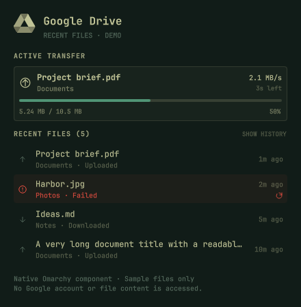
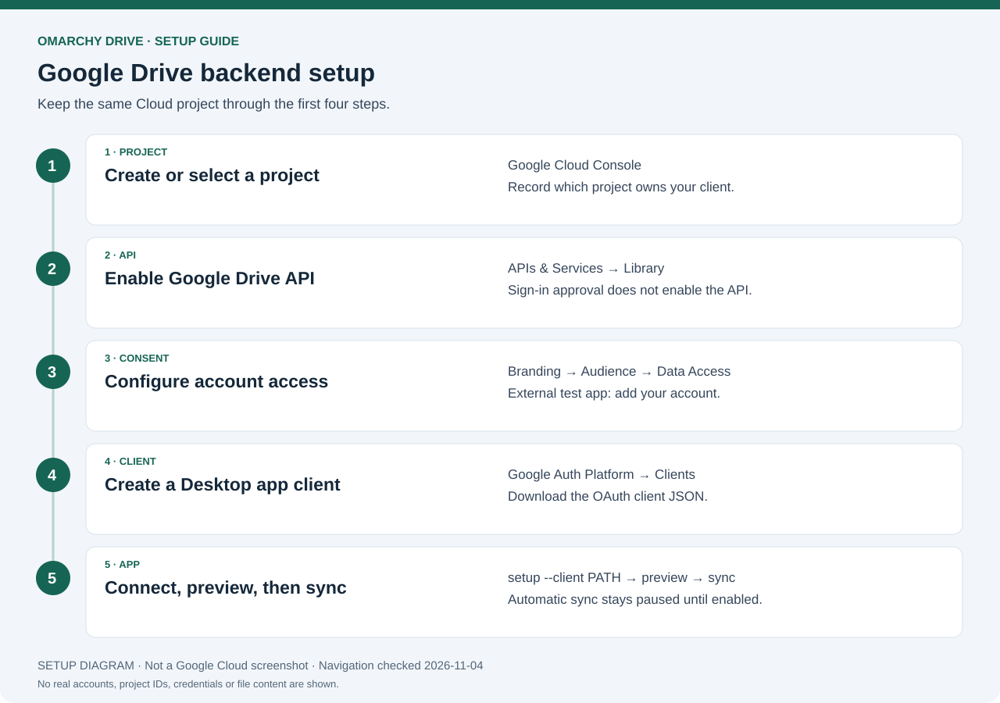

# Omarchy Drive

> Fork of [hominluo/omarchy-google-drive](https://github.com/hominluo/omarchy-google-drive),
> adapted to use our standalone Google Drive API backend instead of rclone.

This version retains the original panel, keyboard navigation and Google Drive icon
by **Homin Luo**, including work credited upstream to **Wesley Cole**. The
replacement sync backend, and the Folders list that replaces the original folder
picker, are by **xJaike**. This is an independent fork, not an official upstream
release.

**No rclone, Insync, or FUSE is required.** See [NOTICE.md](NOTICE.md) for provenance
and trademark information, and [LICENSE](LICENSE) for the retained MIT copyright
notices.

The bar is icon-only. Its badge changes for uploading/downloading, syncing,
up-to-date, paused, offline and error states. Hover for the status and a
summary of the last sync; the panel shows each file's progress. Left-click
opens the panel; right-click refreshes it.



*The actual `RecentFiles.qml` component rendered with sample files. No personal
account or file history is shown.*

## Full setup documentation

Start with the [illustrated setup guide](docs/STANDALONE_SETUP.md). It covers
plugin installation, Google Cloud project selection, Drive API activation,
OAuth consent, Desktop client creation, browser sign-in, folder selection,
first-sync review, automatic sync and troubleshooting.



*Original setup diagram, not a Google Cloud screenshot. Navigation checked
2026-11-04. See the [visual guide index](docs/README.md) for individual figures
and current official references.*

## Install on Omarchy

Requires Omarchy Quattro, Python 3.11+ with SQLite, systemd user services, a
browser, and `xdg-open`. No Python packages need installing.

```bash
omarchy plugin add https://github.com/xJaike/omarchy-drive.git --enable
```

Open the panel and choose **Install and connect**. This opens a terminal, installs
the user sync helpers, and displays the Google account setup steps. Installation
leaves scheduled sync paused and starts no file transfers.

Alternatively:

```bash
bash ~/.config/omarchy/plugins/io.github.xjaike.google-drive/install.sh
```

Adding this plugin alone displays status and setup guidance using its bundled
backend. It does not require a pre-existing `omarchy-drive` executable. Keep the
installed plugin directory in place while its helper links are installed.

Disable other Drive plugins and sync clients targeting the same folder before
syncing. This fork has its own plugin ID: `io.github.xjaike.google-drive`.

## Google account setup

Use your own **Desktop OAuth client**, created in a Google Cloud project you
control. Existing standalone-backend users keep their saved connection, Drive
folder and sync history; credentials from other sync clients are not imported.

| Stage | Procedure | Visual guide |
| --- | --- | --- |
| 1. Project | Create/select a Cloud project and keep it selected for the next stages. | [Project and API](docs/images/google-project-api.png) |
| 2. API | Enable **Google Drive API** in that project. Sign-in approval alone does not enable it. | [Activation instructions](docs/STANDALONE_SETUP.md#5-enable-the-google-drive-api) |
| 3. Consent | Configure **Branding → Audience → Data Access**. For an External Testing app, add your account as a test user and add the Drive scope. | [Consent settings](docs/images/google-consent.png) |
| 4. Client | Under **Clients**, create a **Desktop app** OAuth client and download its JSON. | [Desktop client](docs/images/google-desktop-client.png) |
| 5. Connect | Keep the terminal open, sign in in the browser, then check and preview before syncing. | [Connection sequence](docs/images/connect-and-sync.png) |

Create an **Omarchy** folder at the root of My Drive. Rename your downloaded
client file to `omarchy-drive-client.json` for the examples below, then run:

```bash
chmod 600 ~/Downloads/omarchy-drive-client.json
~/.local/bin/omarchy-drive setup --client ~/Downloads/omarchy-drive-client.json
~/.local/bin/omarchy-drive doctor
~/.local/bin/omarchy-drive preview
```

Setup selects no folders, so nothing syncs until you tick some in the panel. Tick
them before applying the preview. When the plan looks right, run the first sync:

```bash
~/.local/bin/omarchy-drive sync
```

After success, enable the panel's automatic-sync switch if desired. Keep it off
while reviewing the initial setup.

The required scope is `https://www.googleapis.com/auth/drive`; it grants broad
Drive access. Sync operations are scoped by the configured folder ID. A Web app
client, API key or service-account JSON cannot replace a Desktop OAuth client.

If Google sign-in succeeds but setup reports **403 accessNotConfigured**, enable
the Drive API in the client's project, allow activation to take effect, then run:

```bash
~/.local/bin/omarchy-drive setup --continue
```

For an External app left in Testing, refresh tokens can expire after seven days.
See the full guide for publishing-status considerations, reconnection, using a
different Drive folder and troubleshooting. Publishing is distinct from Google
verification.

## Panel controls

| Control | Behavior |
| --- | --- |
| Checkbox on a folder / Space | Tick or untick a home folder |
| Checkbox on an item inside a folder / Space | Exclude or include that file or subfolder |
| Arrow on a folder / Right, Left | Expand or collapse it |
| Sync now / `s` | Start one sync through the standalone systemd service |
| Automatic sync switch / `a` | Enable or pause the timer |
| `o` | Open the top-level folder under the cursor, when it exists locally |
| Drive web / `b` | Open the configured cloud folder in your browser |
| Backups / `c` | Open the local backup directory |
| `j`, `k`, Up, Down | Move through the list |
| Escape | Close the panel |

The **Folders** list shows one row for each visible home folder and each folder
inside the configured Drive folder, labelled `Home + Drive`, `Home only` or
`Drive only`. A ticked `~/Work` pairs with `Drive/Omarchy/Work`. It does not
silently expand access or sync the rest of My Drive, and nothing outside what you
tick ever syncs. Files added later to a ticked folder are included. Ticking a
`Drive only` row creates the local folder on the next sync.

Unticking a folder or excluding an item stops syncing it and **changes no file on
either side**. Ticking or including it again merges: identical files are
remembered, one-sided files are copied, and differing files keep both versions.
Ticking starts no transfer by itself. Ticking and excluding are unavailable during
a sync, and the checkboxes look disabled until it finishes. Rows can still expand.

Local `.gitignore` files are also respected automatically, including nested rules,
`!` exceptions, and directory patterns. Git must be installed; a Git repository is
not required. Rules apply within each ticked home folder, on both local and Drive
paths, even to files tracked by Git. Global Git ignore rules and `.git/info/exclude`
are not used. Only ignore files already present locally affect the current scan;
a `.gitignore` downloaded from Drive takes effect on the next sync.
Ignored copies stay untouched on both sides. Removing a rule merges those files
again safely. The `.gitignore` files themselves sync unless a rule excludes them.

An item that cannot sync is skipped automatically, and everything else carries on.
That covers symlinks, sockets, FIFOs and devices, nested mounts, unreadable files and
folders, a Google Doc or shortcut sharing a name with a local file, and Drive items
whose names cannot be local paths. A skip changes no file on either side, adds
nothing to your exclusions, and ends by itself once the item can sync, when it merges
safely. The panel shows `N items cannot sync`, which expands to each item and why. The
full list is in `~/.local/state/omarchy-drive-v2/cannot-sync.txt`, and
`omarchy-drive skipped` prints it.

An unreadable file is not backed up while it is skipped, so check this list if you
rely on Drive as a backup.

Some problems still stop the sync, because skipping could hide a real problem or pick
the wrong file: a file on one side and a folder of the same name on the other,
duplicate names on Drive, a Drive item using the app's temporary-file prefix, and a
missing Drive checksum. The panel shows **Exclude this**, or **Untick this** when the
problem is the ticked folder itself. When Drive cannot be read the list shows local
folders only, with a note saying so.

The upstream **Browse all** mount is replaced by **Drive web**. This backend has
no virtual filesystem or on-demand FUSE mount. Native Google Docs/Sheets/Slides
and shortcuts remain available in the browser and are skipped in offline sync.

## Recent files and transfers

While a sync checks for changes, the panel shows which file it is reading and a
running count, first for your files and then for Google Drive.

Sync runs up to **four file transfers at once**, sharing the limit between uploads
and downloads. Folder creation, conflict resolution and removals remain ordered.
If a transfer fails, new transfers stop and active transfers settle before sync
reports the error; completed files retain their checkpoints for the next run.

While it syncs, the heading shows its place in the plan, such as **Syncing · 4 of
120**. The current file has a progress card with direction, filename, parent
folder, percentage, transferred bytes, speed and ETA; a step with nothing to
transfer, such as creating a folder, shows what it is doing instead. Backup
transfers are identified separately from uploads and downloads. The next three
files are listed below the card as **Waiting**, followed by how many more remain.

Recent files show their latest activity in individual rows: filename, parent
folder, status and relative time. Long names are elided in the middle; hover
for the full path, exact timestamp, known size and any saved error. Four rows
are shown initially; **Show history** expands the retained history.

Click a row, or focus it and press Enter/Space, to show its containing local
folder. Missing files fall back to the nearest existing parent. This action
never executes or opens a downloaded file. The failed row’s **retry icon**, when available,
rechecks and retries the complete sync rather than targeting an individual file.

## Sync behavior

- Content checksums detect changes. Conflicting local content is kept as a
  conflict copy; the cloud copy takes the original name.
- **Deletions of tracked, selected files propagate both ways.** Removed or
  overwritten content is backed up locally; cloud deletions use Drive Trash.
- Complete scans, checksum verification, conditional cloud updates, a single
  sync lock, per-file SQLite checkpoints, resumable transfers and bulk-deletion
  limits are handled by the standalone engine.
- Local backups are outside your synced folders, in
  `~/.local/state/omarchy-drive-v2/backups/`. They have no automatic retention
  cleanup. Backups made by earlier versions stay where they were, in
  `~/.GoogleDrive-omarchy-drive-backups/`; the app never moves or deletes them.
- Automatic sync survives panel/shell closure and runs through user services.
- Preview is read-only for file content. Run it before adopting this client for
  important data and keep an independent backup.

Config is in `~/.config/omarchy-drive/`; state is in
`~/.local/state/omarchy-drive-v2/`. XDG base-directory overrides are supported.
The status poll reads local state; the separate folder-list command contacts
Google and caches folder metadata and storage quota. Local byte sizes are bounded
estimates. Neither API credentials nor runtime state belong in the repository.

## Settings

```bash
omarchy bar set io.github.xjaike.google-drive syncIntervalMin 5 --json
omarchy bar set io.github.xjaike.google-drive refreshIntervalSec 2 --json
```

Toggle automatic sync off and on to apply a new sync interval. The Drive folder
is chosen by the backend's initial `setup` command, rather than by bar presentation
settings. See the full setup guide for using a different one.

## Update

```bash
~/.local/bin/omarchy-drive pause
omarchy plugin update io.github.xjaike.google-drive
bash ~/.config/omarchy/plugins/io.github.xjaike.google-drive/install.sh
~/.local/bin/omarchy-drive preview
~/.local/bin/omarchy-drive resume
```

Pause first, because the new code starts working as soon as the plugin files
change. Updating from a version that used `~/GoogleDrive` migrates your settings
within seconds, because the panel's status poll runs the new code, even before the
installer has run. Automatic sync may then run if you left it on.

The installer also pauses scheduled sync while replacing helpers. Review the
preview, and resume only when it looks right and you want automatic sync on.
Preserve local Git changes before updating.

The migration happens once. If `~/GoogleDrive` still holds files, the app stops,
changes nothing, and names what to move. See [the migration steps and how to undo them](docs/STANDALONE_SETUP.md#move-from-the-googledrive-layout).

## Remove

Remove helpers before removing their source directory:

```bash
bash ~/.config/omarchy/plugins/io.github.xjaike.google-drive/uninstall.sh
omarchy plugin remove io.github.xjaike.google-drive
```

Local/cloud files, Google credentials, sync state and backups remain. Removing
only the bar plugin does not remove its user service. Keep modified unit files
for review if the uninstaller reports them.

## Validation

```bash
python3 -m unittest discover -s tests -v
python3 -m compileall -q omarchy_drive gdrive-sync.py configure.py
bash -n install.sh uninstall.sh
omarchy plugin validate .
```

Tests use temporary files, a local Drive protocol server, and fake user services.
They do not contact a real Google account. End-to-end account checks require your
own OAuth client. This is an independent fork; upstream's sync-engine behavior
and release claims do not automatically apply to it.

License: [MIT](LICENSE).

The panel follows Omarchy’s active theme automatically, including popup colors,
status accents, muted text, and the shell font. Theme changes apply live.

### Known limits

- Local and Drive names must match, under one Drive parent folder.
- A renamed excluded path is no longer excluded.
- A folder cannot be excluded while keeping one file inside it. The alternative
  is to leave it ticked and exclude everything else, though later additions will
  sync.
- A small subfolder moved out of a ticked folder still counts as deleted: Drive
  copies go to Trash with a local backup, subject to the deletion limit.
- One problem folder pauses sync for all folders until it is resolved.

Only visible folders directly inside your home directory can be ticked. Hidden
folders, the home directory itself, symlinks, and folders on another filesystem
cannot. A ticked folder that disappears or is replaced stops syncing instead of
being treated as deleted content. Google Docs, Sheets, Slides and shortcuts do not
sync and show greyed out. Normal two-way deletion rules apply while a folder is
ticked: cloud deletions preserve local backup copies, and local deletions move the
cloud copy to Trash.
