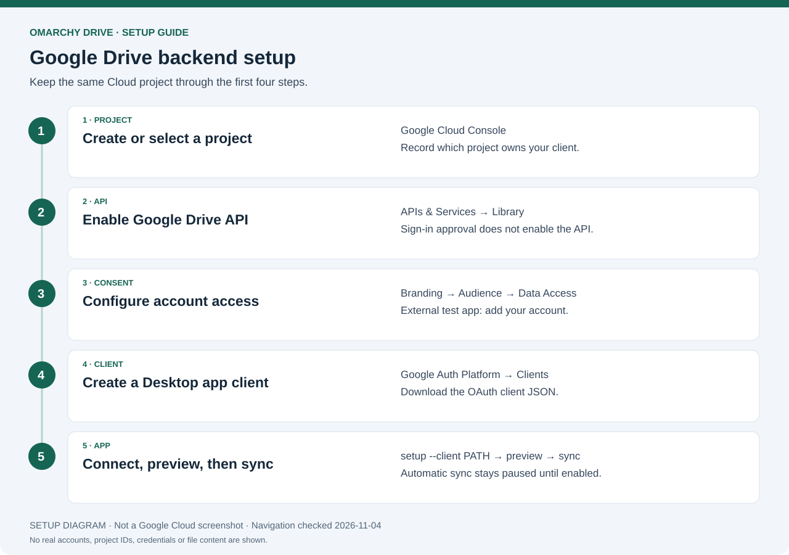
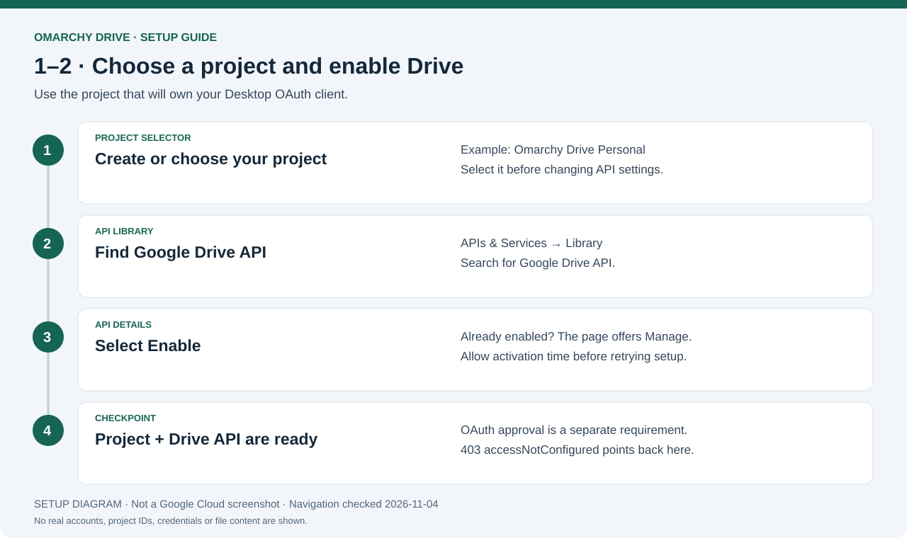
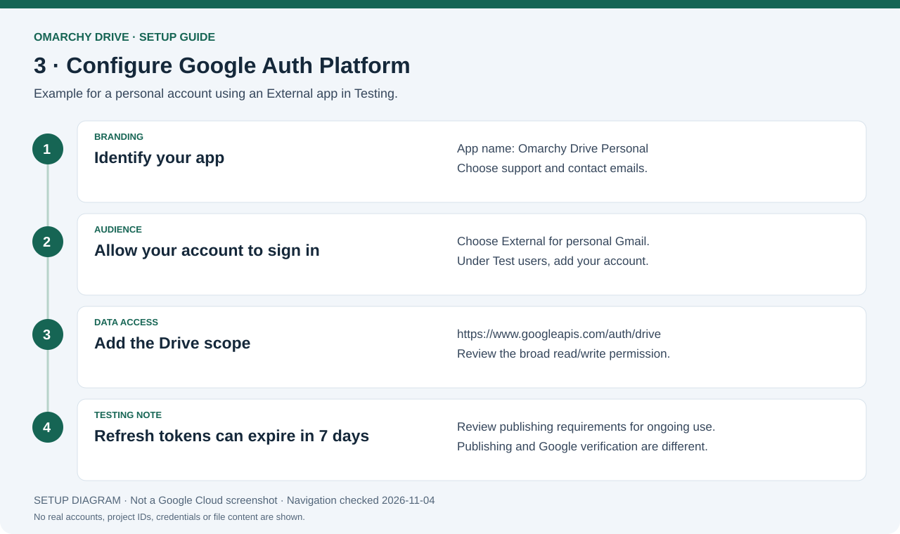
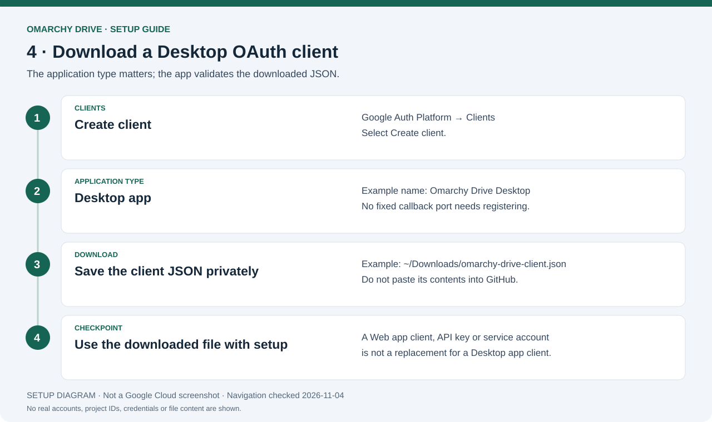
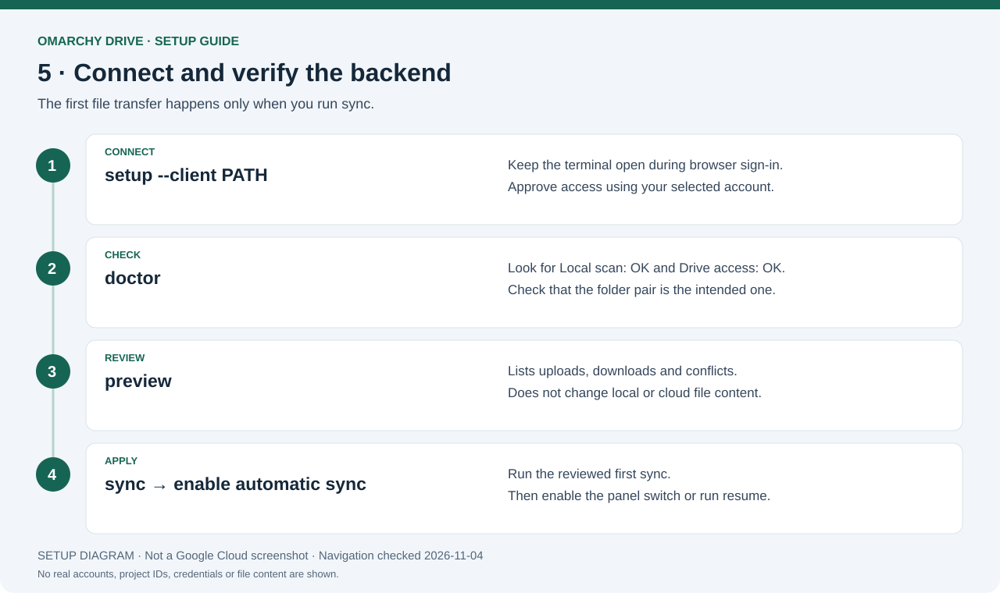
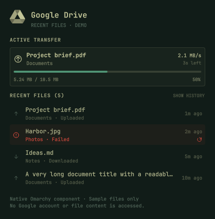
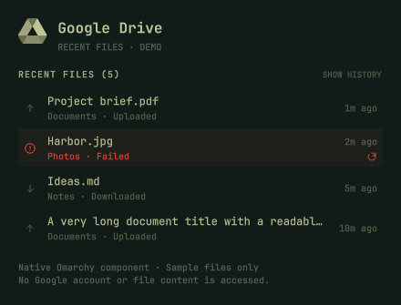
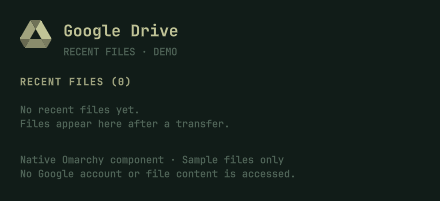

# Setup documentation and image index

Use the [full step-by-step setup guide](STANDALONE_SETUP.md) to install the
Omarchy plugin and connect the standalone Google Drive backend.

## Start here

1. [Install the plugin and sync helpers](STANDALONE_SETUP.md#2-download-and-install-the-app).
2. [Prepare the cloud folder](STANDALONE_SETUP.md#3-prepare-your-google-drive-folder).
3. [Create a Cloud project](STANDALONE_SETUP.md#4-create-a-google-cloud-project).
4. [Enable the Drive API](STANDALONE_SETUP.md#5-enable-the-google-drive-api).
5. [Configure consent and test-user access](STANDALONE_SETUP.md#6-configure-google-sign-in).
6. [Download a Desktop OAuth client](STANDALONE_SETUP.md#7-create-and-download-a-desktop-oauth-client).
7. [Sign in from the app](STANDALONE_SETUP.md#8-connect-your-google-account).
8. [Choose folders, check access and preview](STANDALONE_SETUP.md#9-check-access-and-preview-your-first-sync).
9. [Run the first sync](STANDALONE_SETUP.md#10-run-your-first-sync).
10. [Enable the schedule](STANDALONE_SETUP.md#11-enable-automatic-sync).

## Backend setup figures

These are **original navigation diagrams, not screenshots of Google Cloud**.
They explain the sequence without exposing project IDs, emails, OAuth secrets or
tokens. Navigation labels were checked against Google's documentation on
**2026-11-04**; console layouts and account policies can differ.

### Overview



### Select a project and enable the API



The selected project must own both the activated Drive API and your OAuth client.
API activation and consent are independent steps.
[Official API instructions](https://developers.google.com/workspace/guides/enable-apis).

### Configure consent



For a personal External Testing app, add your intended account as a test user.
[Official consent instructions](https://developers.google.com/workspace/guides/configure-oauth-consent).

### Create the Desktop client



Use a Desktop OAuth client rather than web credentials or an API key.
[Official client instructions](https://developers.google.com/workspace/guides/create-credentials).

### Connect and validate



The setup command opens Google's sign-in page. Keep the terminal open until the
callback completes. Setup and preview do not transfer file content.

## Current recent-files UI

These screenshots render the **real shipped QML component** with synthetic files
in a separate documentation preview. They do not read a Google account, trigger
syncing, or expose personal file history. They are component examples, rather
than full-panel or Google Cloud console screenshots.

### Active transfer



### Sync needs attention



### First-run empty state



## Image sources and maintenance

| Files | Provenance |
| --- | --- |
| `images/setup-overview.*` | Original diagram of the app's account setup sequence |
| `images/google-project-api.*` | Original diagram based on Google's API activation instructions |
| `images/google-consent.*` | Original diagram based on Google's consent settings and audience rules |
| `images/google-desktop-client.*` | Original diagram based on Google's Desktop client instructions |
| `images/connect-and-sync.*` | Original diagram of verified app commands |
| `images/recent-files*.png` | Actual RecentFiles.qml rendered with isolated sample data |
| `../preview.png`, `bar.png` | Original upstream screenshots retained with the fork; they show the upstream interface and may include controls replaced in this backend |

SVG source and PNG exports are kept together in `docs/images/`. Regenerate the
figures with Python 3 and `rsvg-convert` (librsvg):

```bash
python3 scripts/render_setup_figures.py
```

Recheck official navigation labels and update the date in the generator when
maintaining the figures. Never replace a labeled diagram with an invented
console screenshot. Real screenshots for publication must show sample data or
have all private account and file information removed.

To recapture the native UI in a running Omarchy/Hyprland session (requires
Quickshell and `grim`):

```bash
python3 scripts/capture_recent_files.py
python3 scripts/capture_recent_files.py --state attention --output docs/images/recent-files-attention.png
python3 scripts/capture_recent_files.py --state empty --output docs/images/recent-files-empty.png
```

The preview briefly displays a separate, non-reserving layer window and captures
only that window's geometry. It never changes the installed plugin or backend
state. The temporary window is closed even if capture fails.
