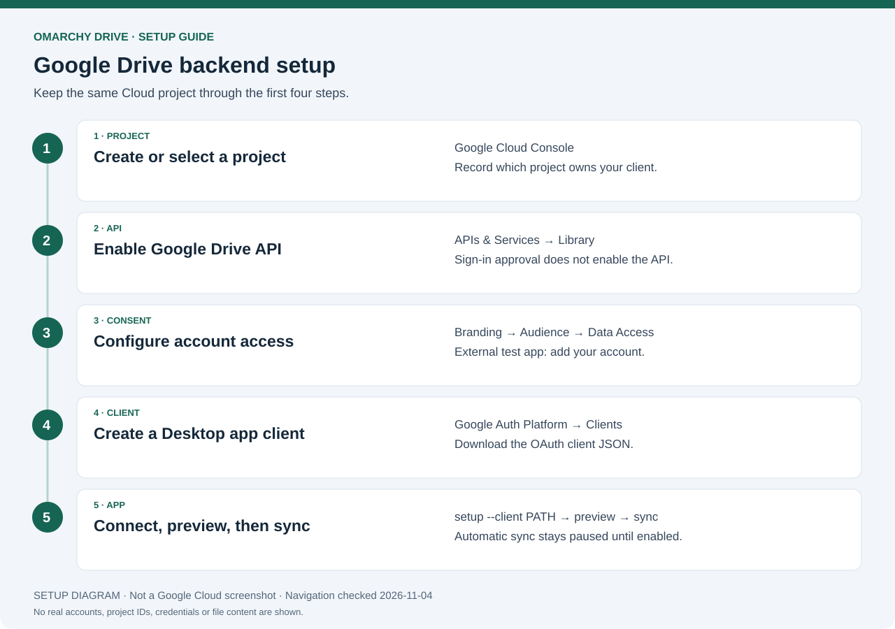
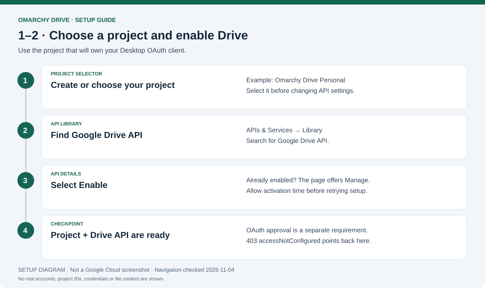
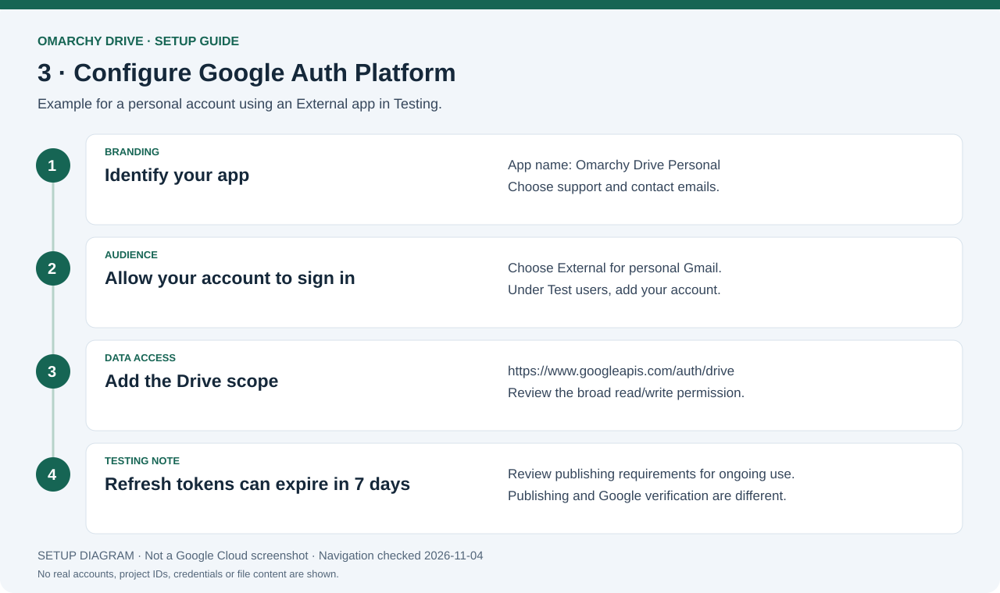
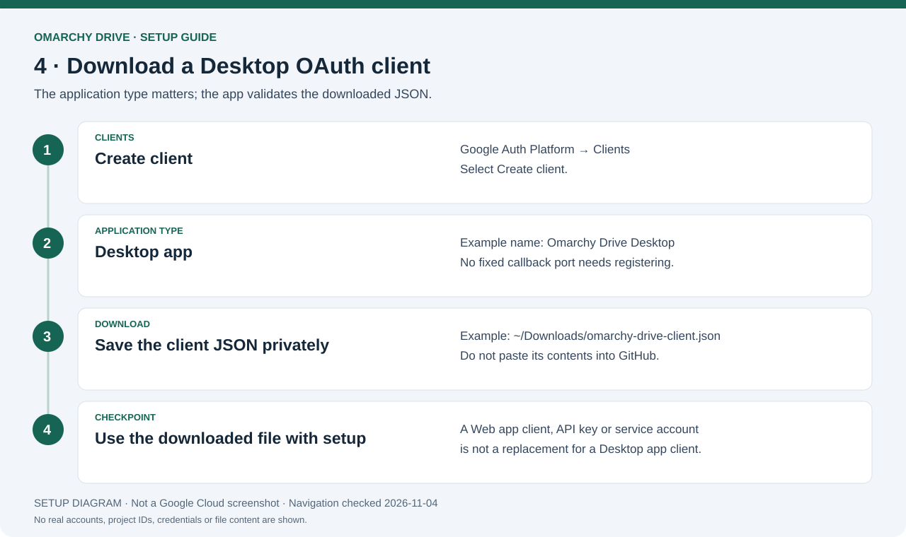
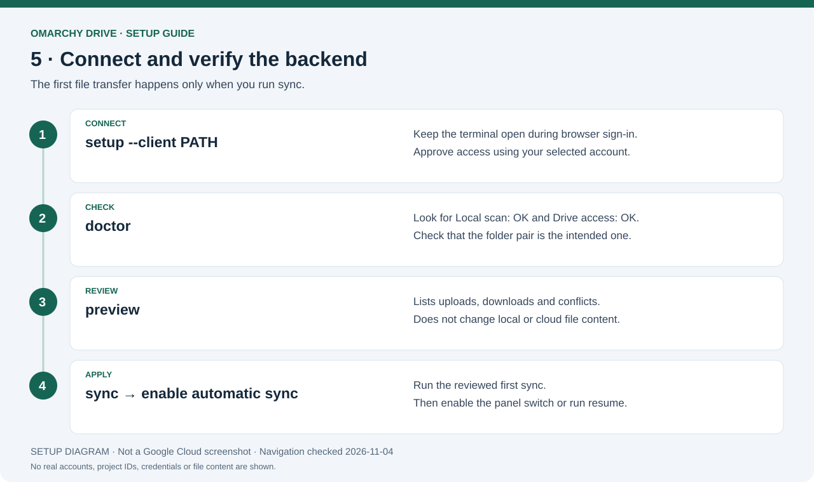
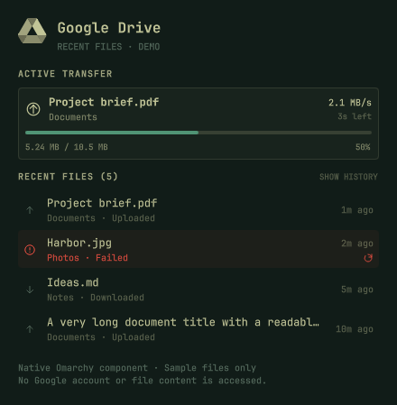

# Full setup: Omarchy Drive and the Google account backend

A standalone Google Drive sync app for Linux, with offline files, a live terminal
dashboard, and an Omarchy bar panel adapted from
[hominluo/omarchy-google-drive](https://github.com/hominluo/omarchy-google-drive). Its Python engine talks directly
to the Google Drive API. **No rclone or Insync is required.**

You choose which home folders sync. Each ticked folder pairs with the folder of
the same name inside your chosen Drive folder, by default **My Drive/Omarchy**:

```text
Your computer:  ~/Documents
Google Drive:   My Drive/Omarchy/Documents
```

Follow the numbered steps below for a new installation. Installation and Google
sign-in do not transfer file content, and nothing syncs until you tick a folder.
You review a preview before the first sync.

**File deletions sync in both directions after files have been tracked.** Keep
an independent backup of important files and use only one sync client on these
folders. Replaced and removed content is retained in local backups.



*Original setup diagram, not a Google Cloud screenshot. Navigation labels were
checked against Google's documentation on 2026-11-04. No real account data is shown.*

For a visual index and the provenance of every image, see [docs/README.md](README.md).

## Contents

- [1. Check requirements](#1-check-requirements)
- [2. Download and install the app](#2-download-and-install-the-app)
- [3. Prepare your Google Drive folder](#3-prepare-your-google-drive-folder)
- [4. Create a Google Cloud project](#4-create-a-google-cloud-project)
- [5. Enable the Google Drive API](#5-enable-the-google-drive-api)
- [6. Configure Google sign-in](#6-configure-google-sign-in)
- [7. Create and download a Desktop OAuth client](#7-create-and-download-a-desktop-oauth-client)
- [8. Connect your Google account](#8-connect-your-google-account)
- [9. Check access and preview your first sync](#9-check-access-and-preview-your-first-sync)
- [10. Run your first sync](#10-run-your-first-sync)
- [11. Enable automatic sync](#11-enable-automatic-sync)
- [12. Open the panel or terminal dashboard](#12-open-the-panel-or-terminal-dashboard)
- [Choose what syncs](#choose-what-syncs)
- [Use a different Drive folder](#use-a-different-drive-folder)
- [Bar widget controls](#bar-widget-controls)
- [Daily commands](#daily-commands)
- [Troubleshooting](#troubleshooting)
- [Sync rules and limitations](#sync-rules-and-limitations)
- [Backups, credentials, and state](#backups-credentials-and-state)
- [Update or migrate an installation](#update-or-migrate-an-installation)
- [Uninstall](#uninstall)
- [Development checks](#development-checks)

## 1. Check requirements

You need:

- Linux with **Python 3.11 or newer**, including its standard-library SQLite module.
- Git to download this repository.
- A working **systemd user session** for installation and automatic sync.
- A browser on the same computer for Google sign-in.
- A Google account with access to My Drive and Google Cloud Console.
- Enough free disk space for offline files, temporary transfers, and backups.
- `xdg-open` for opening folders from the app.

Omarchy Quattro is required only for the optional bar widget. Manual sync uses
Python's standard library; no `pip install` or virtual environment is needed.

Check your environment:

```bash
python3 --version
python3 -c 'import sqlite3; print("SQLite support is available")'
git --version
systemctl --user --version
command -v xdg-open
```

Run installation and app commands as your normal desktop user, without `sudo`.

## 2. Download and install the app

### Recommended: install as an Omarchy plugin

```bash
omarchy plugin add https://github.com/xJaike/omarchy-drive.git --enable
bash ~/.config/omarchy/plugins/io.github.xjaike.google-drive/install.sh
```

The first command adds the icon and panel. The second installs user-service
helpers. You can instead open the panel and choose **Install and connect**.
If you have not downloaded a Google OAuth client yet, leave the client-path
prompt blank and finish account setup in steps 4–8 below.

The plugin ID is **`io.github.xjaike.google-drive`**. Its directory uses that ID,
even though the repository name is `omarchy-drive`. The widget can show setup
instructions from its bundled backend before command-line helpers are installed.

### Alternative: run from a source checkout

Use this instead of the plugin-directory installer if you want a standalone
checkout. Avoid maintaining two helper installations at once.

```bash
mkdir -p ~/Projects
git clone https://github.com/xJaike/omarchy-drive.git ~/Projects/omarchy-drive
cd ~/Projects/omarchy-drive
bash install.sh
```

If this checkout already exists, use [Update or migrate an installation](#update-or-migrate-an-installation).

### What installation changes

The installer stops the previous standalone schedule, saves replaced helpers and
service files, installs commands in `~/.local/bin`, and adds a terminal launcher.
It leaves automatic sync paused, retains existing credentials and state, and
starts no file transfers. It does not remove an unrelated sync client: stop
other clients targeting the same folder before syncing.

Verify the installed backend:

```bash
~/.local/bin/omarchy-drive --version
```

Expected version: **2.1.0**. Later steps use the short `omarchy-drive` command.
If it is not found, use its full path above or add the helper directory to PATH:

```bash
export PATH="$HOME/.local/bin:$PATH"
```

Add that line to your shell startup file if needed, then open a new terminal.
Keep the source directory used for installation in place: the helpers link to
its files. For plugin installations, uninstall helpers before removing the plugin.

## 3. Prepare your Google Drive folder

1. Open [Google Drive](https://drive.google.com/) with the account you want to sync.
2. Open **My Drive**.
3. Create a folder named **Omarchy**, or use your existing folder with that name.
4. Make sure exactly one item at the root of My Drive uses that name and that it
   is a folder outside Trash.

Files can already exist in this folder. When you tick a home folder of the same
name as a folder inside it, the first sync merges both sides and preserves
differing versions as conflict copies. Loose files directly in this folder stay on
Drive and do not sync.

For another folder name, an explicit folder ID, or automatic remote-folder
creation, see [Use a different Drive folder](#use-a-different-drive-folder).

## 4. Create a Google Cloud project



*Navigation diagram for steps 4–5; this is not a console screenshot.*


This app uses your own OAuth client to request access to your Google account.
The repository does not contain shared Google credentials.

1. Open [Google Cloud Console](https://console.cloud.google.com/).
2. Sign in with an account that can manage your Cloud project.
3. Open the project selector at the top of the page.
4. Choose **New Project**, enter a name such as **Omarchy Drive Personal**, and
   create it. You can also use an existing project you control.
5. Select that project after it is created.

Use **this same project** for API activation, consent settings, and the OAuth
client in the next three steps. The project selector should stay on it.

## 5. Enable the Google Drive API

**Successful Google sign-in does not enable the Drive API.** These are separate
requirements. Skipping this step causes HTTP 403 `accessNotConfigured`.

1. With your project selected, open **APIs & Services → Library**.
2. Search for **Google Drive API**, or open its
   [API Library page](https://console.cloud.google.com/apis/library/drive.googleapis.com).
3. Confirm the project selector still shows your chosen project.
4. Click **Enable**. If it is already active, the page normally offers **Manage**.
5. Allow activation to take effect before connecting the app.

See Google's [API activation instructions](https://developers.google.com/workspace/guides/enable-apis).

## 6. Configure Google sign-in



*Navigation diagram. Your email, project name and publishing choices will differ.*


Google's console labels can change. The relevant pages are under **Google Auth
Platform**: **Branding**, **Audience**, and **Data Access**.

1. Open **Google Auth Platform → Branding** and choose **Get Started** if prompted.
2. Enter an app name, support email, and contact email; complete the consent setup.
3. For a personal Gmail account, choose **External** as the audience.
4. In **Audience → Test users**, add the exact Google account you will use to sync.
5. In **Data Access → Add or remove scopes**, add:

   ```text
   https://www.googleapis.com/auth/drive
   ```

6. Save your changes.

This scope permits broad Drive access. The app requests it to sync an existing
folder; its sync engine operates on the folder ID selected during setup. Review
Google's consent screen before granting access.

See Google's [consent setup guide](https://developers.google.com/workspace/guides/configure-oauth-consent).
Workspace accounts may have organization policies that require administrator
approval.

### Testing mode and weekly sign-in expiry

For an External app in **Testing**, Google limits authorizations for scopes such
as Drive to seven days, including offline refresh tokens. Automatic refresh does
not remove this limit. See [Google's audience rules](https://support.google.com/cloud/answer/15549945).

Testing is suitable for the initial connection. For ongoing use, review the
**Audience → Publishing status** settings and Google's requirements before
switching to production. Publishing status and app verification are separate;
this README does not imply that the project is verified by Google. After a token
expires, reconnect as described under [Google sign-in expired](#google-sign-in-expired-or-invalid_grant).

## 7. Create and download a Desktop OAuth client



*Navigation diagram. Client IDs and secrets are intentionally omitted.*


1. In the same Cloud project, open **Google Auth Platform → Clients**.
2. Click **Create client**.
3. Set **Application type** to **Desktop app**.
4. Enter a name such as **Omarchy Drive Desktop** and click **Create**.
5. Download the client's JSON file, using the download control on its details page
   if the creation dialog does not offer one.
6. For the commands below, rename the downloaded file in your file manager to:

   ```text
   omarchy-drive-client.json
   ```

7. Leave it in your `Downloads` folder and restrict access:

   ```bash
   chmod 600 ~/Downloads/omarchy-drive-client.json
   ```

Use a **Desktop app** client. A web client, API key, or service-account JSON will
not work with this setup flow. You do not need to register a fixed callback port;
the app starts a temporary loopback callback on your computer.

See Google's [Desktop OAuth client instructions](https://developers.google.com/workspace/guides/create-credentials).
Keep the JSON private; do not commit it to Git or paste its contents into an issue.

## 8. Connect your Google account



*Command-flow diagram. Each command is explained in the next steps.*


Run:

```bash
omarchy-drive setup --client ~/Downloads/omarchy-drive-client.json
```

If you kept Google's original downloaded filename, use that actual path instead.
Quote the full path if it contains spaces.

1. Leave the terminal open while the browser opens Google sign-in.
2. Select the account added as a test user.
3. Check that the consent page identifies the app and project you created.
4. Grant the requested Drive access.
5. Wait for the browser to say you can return to Omarchy Drive.
6. Return to the terminal and wait for setup to finish checking the remote folder.

Expected terminal result:

```text
Connected. No files were transferred. Next: omarchy-drive preview
```

The app saves its client configuration and refresh token locally with private
permissions. Subsequent syncs refresh access tokens automatically when possible.
It does not read credentials from another sync client. The browser flow uses
OAuth state validation and PKCE, following Google's
[installed-app OAuth flow](https://developers.google.com/identity/protocols/oauth2/native-app).

If sign-in succeeds but folder checks fail, fix the reported problem and resume
with the saved sign-in:

```bash
omarchy-drive setup --continue
```

`--continue` finishes setup; it does not start syncing. If no saved sign-in exists,
use `setup --client PATH` instead.

## 9. Check access and preview your first sync

Open the bar panel and tick the folders you want in the **Folders** list. See
[Choose what syncs](#choose-what-syncs). A fresh setup ticks nothing, so a sync
before this step transfers nothing.

First run a read-only file and access check:

```bash
omarchy-drive doctor
```

Look for **Local scan: OK** and **Drive access: OK**. A baseline of zero files is
normal before the first sync.

Then preview the proposed changes:

```bash
omarchy-drive preview
```

| Preview action | What applying it does |
| --- | --- |
| `mkdir-local` | Creates a local directory |
| `mkdir-remote` | Creates a Drive directory |
| `upload` | Sends local content to Drive |
| `download` | Downloads Drive content to the local folder |
| `conflict` | Keeps both versions under separate names |
| `archive-local` | Archives an unchanged local file deleted from Drive |
| `trash-remote` | Moves an unchanged Drive file deleted locally to Drive Trash |

Preview does not upload, overwrite, or remove file content. It can refresh sign-in
and initialize local bookkeeping. It displays large deletion plans for review;
normal sync still enforces the deletion limits.

Check that the folders and proposed transfers match your intentions before
running sync. A preview is a snapshot: the app scans again when applying changes.

## 10. Run your first sync

Run:

```bash
omarchy-drive sync
```

Wait until it reports:

```text
Up to date. Applied N changes.
```

`N` is the number of changes for your run. Open a ticked home folder and its partner
inside **My Drive/Omarchy** in the browser to check the result.

To confirm convergence, run another preview:

```bash
omarchy-drive preview
```

If neither side changed, it should report **0 proposed changes**. Google-native
documents and shortcuts are excluded, so their absence locally is expected.

## 11. Enable automatic sync

After a successful manual sync, enable the timer:

```bash
omarchy-drive resume
```

Verify the schedule:

```bash
systemctl --user status omarchy-drive-sync.timer --no-pager
systemctl --user list-timers omarchy-drive-sync.timer --no-pager
```

The timer schedules another run about one minute after the previous service run
finishes. It does not overlap sync operations. This is polling, not instant
Google Drive push notifications. These are user services; automatic sync normally
runs while your user session is active and the computer is awake.

Pause future runs:

```bash
omarchy-drive pause
```

Pausing disables the timer and allows an already active transfer to finish.
Closing the dashboard does not pause scheduled sync.

## 12. Open the panel or terminal dashboard



*Actual plugin component, rendered with sample files in an isolated preview.
This screenshot contains no personal account information.*


Left-click the Drive bar icon for the native panel. Right-click refreshes status;
hovering shows current transfers, the waiting queue, and recent file history.
The panel includes **Sync now**, **Backups**, **Drive web**, the schedule switch,
and the **Folders** list.
**Drive web** opens the configured cloud folder in a browser; it does not mount it.

Recent-file rows show the latest event for each retained file, with upload/download
indicators, failure labels and readable filenames. Hover a row for its full
relative path, exact timestamp, known size and saved failure details. Click it
to show the local containing folder; an absent file falls back to an existing
parent. The action does not open or execute the downloaded file.

Use **Show history** to expand the four-row history. If the latest sync needs
attention, the failed row’s **retry icon** starts a full checked sync. The progress card describes
the active transfer, while the remaining count describes the overall plan.

For a separate terminal dashboard, run:

```bash
omarchy-drive
```

You can also open **Omarchy Drive** from the application menu. It opens in a
terminal and shows status, current transfers, and recent activity.

| Key | Action |
| --- | --- |
| **S** | Sync now |
| **V** | Preview changes |
| **D** | Check connection and local files |
| **C** | Show setup instructions |
| **P** | Pause scheduled sync |
| **R** | Resume scheduled sync |
| **O** | Open your home folder |
| **Q** | Close the dashboard |

After an action finishes, press **Enter** to return to the dashboard. The **C**
key shows instructions; use `setup --client PATH` in a terminal to connect.

## Choose what syncs

The panel's **Folders** list has one row for each visible home folder and each
folder inside your chosen Drive folder.

| Label | Meaning |
| --- | --- |
| `Home + Drive` | The folder exists on both sides |
| `Home only` | Only in your home folder. Ticking it creates the Drive folder on the next sync |
| `Drive only` | Only on Drive. Once ticked it reads `will create ~/Name`, and the next sync creates that folder |

**Tick a folder** to sync it in place. Its files stay where they are, with no
symlinks or extra copies, and files added to it later are included. Nothing outside
what you tick ever syncs. Ticking starts no transfer: the next scheduled sync or
**Sync now** does the work, so you can run `omarchy-drive preview` first.

**Expand a folder** with its arrow or the Right key to list its contents, and tick
or untick items to include or exclude them. This also works on a folder that is
not ticked yet, so you can set exclusions first. Rows beneath an excluded folder
show as `excluded` and cannot be changed individually. An exclusion is an exact
path; there are no patterns.

**Untick or exclude** to stop syncing. No file changes on either side and nothing
is written to Drive. Ticking or including it again merges: identical files are
remembered, one-sided files are copied, and differing files keep both versions.
Selection changes wait until an active sync finishes.

Keyboard: Up and Down move through the rows, Right expands, Left collapses, Space
toggles the tick, and `o` opens the top-level folder under the cursor when it
exists locally.

Some rows cannot be ticked, and show the reason. Hidden folders are never offered
from your home folder, and a hidden Drive folder is greyed out. So is a Drive folder
whose name is already used by a file in your home folder. Google Docs and shortcuts
are greyed out, because they do not sync. Symlinks, sockets and similar items show
a warning and can be excluded.

When one path stops a sync, the panel shows the error and **Exclude this**. When
the problem is a ticked folder itself, such as one that is missing, it shows
**Untick this** instead. The panel never does either by itself.

When Drive cannot be read, the panel says `Drive could not be read. Showing local
folders only.` Reading can take a few minutes to give up, and an expanding row
shows `Loading…` meanwhile.

### Known limits

- Local and Drive names must match, under one Drive parent folder.
- A renamed excluded path is no longer excluded.
- A folder cannot be excluded while keeping one file inside it. The alternative
  is to leave it ticked and exclude everything else, though later additions will
  sync.
- A small subfolder moved out of a ticked folder still counts as deleted: Drive
  copies go to Trash with a local backup, subject to the deletion limit.
- One problem folder pauses sync for all folders until it is resolved.

## Use a different Drive folder

Choose the Drive folder during the **first** setup. These are alternatives to
step 8; pick the command that matches your intended folder.

Use a different folder at the root of My Drive:

```bash
omarchy-drive setup \
  --client ~/Downloads/omarchy-drive-client.json \
  --folder Documents
```

Create the remote folder if it does not already exist:

```bash
omarchy-drive setup \
  --client ~/Downloads/omarchy-drive-client.json \
  --create-folder
```

To select an existing folder by ID, copy the ID from its browser URL. For example,
in `https://drive.google.com/drive/folders/FOLDER_ID`, the final component is the ID:

```bash
omarchy-drive setup \
  --client ~/Downloads/omarchy-drive-client.json \
  --folder-id 'REPLACE_WITH_YOUR_FOLDER_ID'
```

An explicit ID also avoids ambiguity when multiple folders have the same name.
For an unfinished first setup, the same overrides can accompany `setup --continue`.

Once configured, reconnect without overrides. There is no in-place command to
switch to another Drive folder; the sync database is bound to the one you chose.
Do not change `settings.json` to point old sync history at a new folder.

## Bar widget controls

If you followed the recommended plugin installation in step 2, the widget is
already installed. Add it separately only when you used the source-checkout route:

```bash
omarchy plugin add https://github.com/xJaike/omarchy-drive.git --enable
```

The widget calls the installed `~/.local/bin/omarchy-drive` executable.
Adding the widget does not install the sync helpers or enable automatic sync.

| Mouse action | Result |
| --- | --- |
| Left-click | Open the Google Drive panel |
| Right-click | Refresh panel status |
| Hover | Live per-file sync details |

Hover over the widget to see the current filename and whether it is uploading,
downloading, preparing, or saving a backup. During a transfer, the hover details
show per-file percentage, bytes transferred, speed, and an ETA when enough samples
are available. The bar shows `↑` for uploads and `↓` for downloads.

The hover card also lists completed upload/download counts, remaining changes,
up to five waiting files with their planned actions, and five recent completed
or failed files with timestamps. Larger queues show a remaining-item count;
open the panel for more details. Progress percentages describe the
current transfer, not the entire sync. Quiet checks reset current-run counts and
retain recent file history. A failed transfer is marked stopped, so old progress
does not appear as an active upload or download.

The v2 plugin ID is `io.github.xjaike.google-drive`. If you have an older widget
with the ID `omarchy-drive`, that separate copy may still display the old engine's
status. Disable it before enabling the v2 widget:

```bash
omarchy plugin disable omarchy-drive
```

Do this only if that legacy widget is installed. Avoid enabling both versions.

## Daily commands

| Command | Purpose |
| --- | --- |
| `omarchy-drive` | Open the dashboard |
| `omarchy-drive setup` | Show Google Cloud setup instructions |
| `omarchy-drive setup --client PATH` | Sign in or reconnect |
| `omarchy-drive setup --continue` | Finish setup using saved sign-in |
| `omarchy-drive doctor` | Check local files and remote access |
| `omarchy-drive preview` | Show proposed file changes |
| `omarchy-drive sync` | Apply a sync immediately |
| `omarchy-drive pause` | Disable scheduled sync |
| `omarchy-drive resume` | Enable scheduled sync |
| `omarchy-drive open` | Open your home folder |
| `omarchy-drive status` | Print JSON status |
| `omarchy-drive --help` | Show available commands |
| `omarchy-drive setup --help` | Show setup options |

## Troubleshooting

### HTTP 403: `accessNotConfigured` or `SERVICE_DISABLED`

OAuth sign-in succeeded, but the Drive API is disabled or not yet active in the
project that owns the client.

1. Open [Google Drive API activation](https://console.cloud.google.com/apis/library/drive.googleapis.com).
2. Select the project that owns your downloaded OAuth client.
3. Click **Enable**, or check that the API is already active.
4. Allow a few minutes for activation, then run:

   ```bash
   omarchy-drive setup --continue
   ```

Enabling the API in a different Cloud project does not fix this client. This is
API activation, not another consent-screen permission. See Google's
[API Console instructions](https://support.google.com/googleapi/answer/6158841).

### Browser sign-in is blocked or access is denied

Check that you used the correct Google account and added it under **Audience →
Test users** for a Testing app. Workspace policies may also block approval.
If Google shows an unverified-app notice, confirm that it is your own project
and review the requested access before proceeding. Do not proceed for an app
you do not recognize.

### The browser does not open or the callback times out

Open the sign-in URL printed by the running setup command in a browser on the
**same computer**. Keep the terminal open. The callback uses `127.0.0.1`, so
opening it on another computer or phone does not complete this flow.

If the command already timed out, run `setup --client PATH` again to get a new
URL. Old callback ports and URLs are temporary.

### The app says to choose a Desktop OAuth client

Create a client with application type **Desktop app** and download its JSON.
Web-app and service-account credentials are not accepted. Use the actual file
path when running `setup --client PATH`.

### Google sign-in expired or `invalid_grant`

Reconnect with your downloaded client:

```bash
omarchy-drive setup --client ~/Downloads/omarchy-drive-client.json
```

Omit folder overrides for an existing configuration. Then check access and
preview before syncing:

```bash
omarchy-drive doctor
omarchy-drive preview
```

`setup --continue` reuses saved authorization; it does not renew a revoked or
expired refresh token. For weekly expiry, review the Testing-mode explanation
in [step 6](#testing-mode-and-weekly-sign-in-expiry).

### The Omarchy folder is missing or ambiguous

Create or restore the folder in My Drive, or use its ID during first setup.
If Google allows duplicate names, rename duplicates or choose `--folder-id ID`.
After a post-sign-in setup failure, retry with `setup --continue`.

For an already tracked pair, restore the original remote folder from Trash.
Creating a new folder with the same name does not recreate its original ID.

### Network or DNS error

Your local files remain available offline. Restore the connection, then run:

```bash
omarchy-drive doctor
omarchy-drive sync
```

If the timer is enabled, later scheduled runs retry. An interrupted transfer can
resume from saved progress; there is no v1-style `--repair` command in this app.

### Another sync or setup is running

Only one operation can hold the app lock. Let it finish, or inspect the service:

```bash
systemctl --user status omarchy-drive-sync.service --no-pager
```

Do not remove lock files while another process is active. Starting another
sync does not create a second concurrent transfer.

### A home folder was moved, replaced, or contains unsupported items

Restore the ticked folder to its original path, or untick it in the panel. The app
checks the folder's identity, so recreating an empty directory with the same name
is not a substitute for restoring it. Unticking it and ticking it again merges safely.

For a symlink, special file, nested mount, or file/folder name collision inside a
ticked folder, use **Exclude this** in the panel, or move or rename the item. Then
preview again. Do not reset the database just to bypass these checks.

### A large deletion plan is blocked

Run `omarchy-drive preview` and check both folders. If the deletion is intended,
apply that run explicitly:

```bash
omarchy-drive sync --allow-many-deletes
```

Use this only after reviewing the proposed deletions. The override applies to
that invocation; it does not disable safeguards for future scheduled runs.

### No provider ETag, HTTP 412, or a file changed during sync

The app refuses cloud overwrites or trash operations when Google does not supply
a usable ETag. These two writes use Drive API v2 because v3 does not return ETags
or enforce `If-Match`. HTTP 412 or a changed-version message can indicate concurrent
modification. Let edits finish, stop other sync clients, and preview again.
If the error persists, keep the files and database and report the sanitized
error. There is no command to bypass version preconditions.

### `systemctl --user` cannot connect to the session bus

Run the installer in a terminal inside your normal desktop login, as that user.
Do not use `sudo bash install.sh` or `sudo omarchy-drive`. The installer targets
user services, not system services. On Linux environments without a systemd user
manager, the supplied installer and schedule are unavailable; manual operations
can be run from the checkout with `./bin/omarchy-drive` and its subcommands.

### Need service logs

```bash
omarchy-drive status
journalctl --user -u omarchy-drive-sync.service -n 50 --no-pager
```

Review logs before sharing. Do not publish OAuth JSON, tokens, database contents,
or upload-session URLs. Activity and status can contain personal filenames.

## Sync rules and limitations

- Content checksums determine file changes; clock differences do not decide
  which conflicting version wins.
- First sync merges both sides. If both copies differ, the local version is
  preserved as `name.conflict-local-CHECKSUM.ext` on both sides, while the Drive
  version takes the original path. Later simultaneous edits use the same rule.
- **File deletions propagate in both directions.** Unchanged local files removed
  from Drive are archived. Unchanged cloud files removed locally go to Drive
  Trash. An edit competing with a deletion is preserved and restored to the
  other side. The app never permanently deletes Drive files.
- More than 20 deletions, or more than 25% of a baseline with at least 20 files,
  block normal sync pending review.
- Empty directories are created and retained. Folder moves and renames reconcile
  through file operations, so old empty directories can remain.
- Native Google Docs, Sheets, Slides, and shortcuts are skipped. A skipped item
  colliding with a local path blocks sync rather than overwriting it.
- This version targets My Drive. Shared drives and exclusion patterns are not
  implemented. The legacy root `RCLONE_TEST` marker is ignored.
- Local hashes and complete remote folder listings run each cycle. Large trees
  can take time to scan even when no files need transferring.
- Uploads use persisted resumable sessions and pre-generated Drive IDs.
  Downloads use verified partial files before publishing complete content.
- SQLite checkpoints each completed file. A later failure retains completed
  checkpoints and pending transfers. A corrupt database is never silently reset.
- Concurrent editing across applications and devices is not atomic. The app
  checks versions, preserves backups, and stops when it detects conflicting
  activity. Automated tests are not a guarantee of production reliability.
- See also the [known limits](#known-limits) of ticked folders and exclusions.

## Backups, credentials, and state

Default locations:

| Location | Contents |
| --- | --- |
| `~/.local/state/omarchy-drive-v2/backups/` | Replaced and removed local/cloud content |
| `~/.GoogleDrive-omarchy-drive-backups/` | Backups made by earlier versions, left where they were |
| `~/.config/omarchy-drive/client.json` | Saved Desktop OAuth client |
| `~/.config/omarchy-drive/tokens.json` | Google access and refresh tokens |
| `~/.config/omarchy-drive/settings.json` | Drive folder, ticked folders, exclusions and settings |
| `~/.local/state/omarchy-drive-v2/sync.sqlite3` | Baseline, pending sessions, and recent activity |
| `~/.local/state/omarchy-drive-v2/status.json` | Latest recorded status |
| `~/.local/state/omarchy-drive-v2/install-backups/` | Replaced installation files |

`XDG_CONFIG_HOME`, `XDG_STATE_HOME`, and `XDG_DATA_HOME` override the corresponding
base directories. Ticked folders must be on the same filesystem as the state
directory, because backups move files there. The app never moves or deletes old
`~/.GoogleDrive-omarchy-drive-backups` folders.

Backups are outside your synced folders and have no automatic retention cleanup.
Before restoring a file, pause scheduled sync and wait for active transfers to
finish. Copy a backup to a separate recovery folder, inspect it, then restore
it into its synced folder and preview the resulting changes. A restored file
can upload again on the next sync.

Keep the database and any `-wal`/`-shm` companions together when making a stopped
app backup. Do not delete state as a routine troubleshooting step: without a
baseline, the next run merges existing content instead of inferring deletions.
Do not edit stored credentials or session records manually.

## Update or migrate an installation

### Installed as an Omarchy plugin

```bash
omarchy-drive pause
omarchy plugin update io.github.xjaike.google-drive
bash ~/.config/omarchy/plugins/io.github.xjaike.google-drive/install.sh
omarchy-drive doctor
omarchy-drive preview
```

Preserve local Git changes before updating. The installer leaves automatic sync
paused; after review, use the panel's switch to resume.

### Installed from a source checkout

For the checkout location used in this guide:

```bash
systemctl --user disable --now omarchy-drive-sync.timer
systemctl --user stop omarchy-drive-sync.service
cd ~/Projects/omarchy-drive
git status --short
git pull --ff-only
bash install.sh
omarchy-drive --version
```

If `git status` shows local changes, preserve or resolve them before pulling;
do not discard them to force an update. The installer leaves automatic sync
paused. For an already connected v2 installation, check and resume:

```bash
omarchy-drive doctor
omarchy-drive preview
omarchy-drive sync
omarchy-drive resume
```

### Move from the `~/GoogleDrive` layout

Earlier versions synced one local folder, `~/GoogleDrive`, plus optional home
folders. The first command or panel read after updating migrates your settings
once, under the sync lock:

1. If the sync history belongs to a different Drive folder, it stops and changes
   nothing.
2. If `~/GoogleDrive` holds anything other than `RCLONE_TEST` or app temporary
   files, it stops, changes nothing, and names the items. Move them into your home
   folder and tick them there. This check repeats on each run until the folder is
   clear.
3. It saves `settings.json.pre-migration` and `identity.pre-migration` in
   `~/.config/omarchy-drive/`, then rewrites the settings and the database's identity
   value.

Home folders you had already selected stay ticked with their sync history, so a
preview should show no changes for them. `~/GoogleDrive` is left in place and stops
syncing; the app never moves or deletes it. Old backups stay in
`~/.GoogleDrive-omarchy-drive-backups/`.

### Undo the migration

Do this only with the previous version of the app. This version migrates again as
soon as it reads the restored settings, and its bar panel reads them every few
seconds, so put the previous version back first. Folders you ticked and exclusions
you added since the migration are forgotten.

1. Make sure no sync is running:

   ```bash
   systemctl --user disable --now omarchy-drive-sync.timer
   systemctl --user stop omarchy-drive-sync.service
   ```

2. Copy the saved settings back:

   ```bash
   cp ~/.config/omarchy-drive/settings.json.pre-migration ~/.config/omarchy-drive/settings.json
   ```

3. Set the database's identity value to the exact contents of
   `identity.pre-migration`. Skip this step if that file does not exist, because then
   the migration did not change the value.

   ```bash
   python3 - <<'EOF'
   from pathlib import Path
   import sqlite3
   home = Path.home()
   identity = (home / '.config/omarchy-drive/identity.pre-migration').read_text()
   db = sqlite3.connect(home / '.local/state/omarchy-drive-v2/sync.sqlite3')
   with db:
       db.execute("UPDATE metadata SET value = ? WHERE key = 'identity'", (identity,))
   db.close()
   EOF
   ```

4. Delete both saved files:

   ```bash
   rm -f ~/.config/omarchy-drive/settings.json.pre-migration ~/.config/omarchy-drive/identity.pre-migration
   ```

If you use `XDG_CONFIG_HOME` or `XDG_STATE_HOME`, change these paths to match.

### Move from v1

When moving from v1, complete Google Cloud setup and sign in with a Desktop
OAuth client. V2 does not import the previous engine's credentials or baseline.
Existing local and remote files are merged on its first sync, which can restore
content that a prior baseline would have treated as deleted. Old state under
`~/.local/state/omarchy-drive-sync/` is retained. Stop any separately configured
sync job touching the same folder, and update or disable a legacy bar widget.

## Uninstall

For the recommended plugin installation, remove helpers before their source:

```bash
bash ~/.config/omarchy/plugins/io.github.xjaike.google-drive/uninstall.sh
omarchy plugin remove io.github.xjaike.google-drive
```

For a source-checkout installation, run its uninstaller instead:


```bash
cd ~/Projects/omarchy-drive
bash uninstall.sh
```

This stops scheduled sync and removes owned helper links, unmodified units,
and the owned application launcher. Modified service files are retained for
manual review. Local files, cloud files, backups, credentials, and the sync
database remain.

If installed, remove the optional v2 bar plugin separately:

```bash
omarchy plugin remove io.github.xjaike.google-drive
```

Deleting the app's Google connection from your Google Account revokes its access;
uninstalling the local helpers alone does not revoke tokens.

## Development checks

Run from the repository root:

```bash
python3 -m unittest discover -s tests -v
python3 -m compileall -q omarchy_drive
bash -n install.sh uninstall.sh
```

For the optional plugin on Omarchy:

```bash
omarchy plugin validate .
```

The suite covers reconciliation with real temporary files, protocol behavior
through a local HTTP server, OAuth callback and refresh handling, resumable
transfers, conflicts, deletion safeguards, installation, and terminal controls.
Tests do not contact a live Google account. Actual sign-in and end-to-end Google
Drive compatibility must also be checked with your own client and account.

License: [MIT](../LICENSE).

